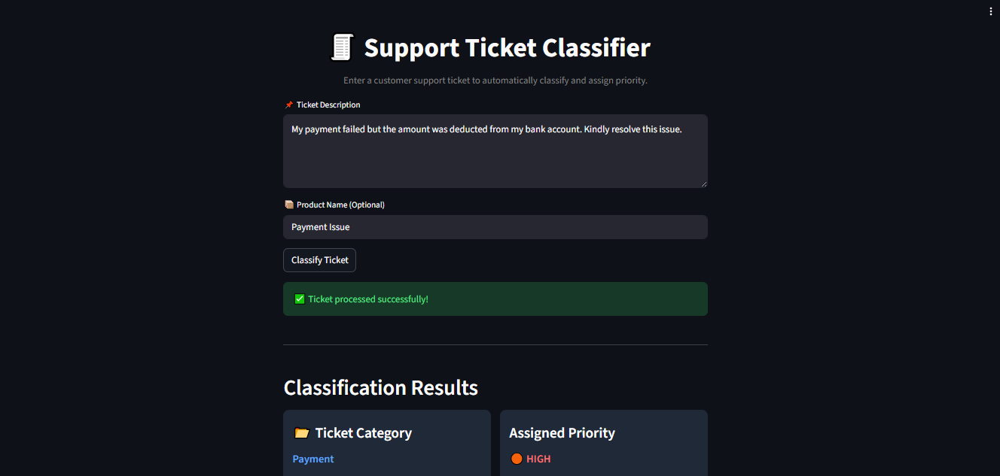

# 🧾 Support Ticket Classification System

An AI-powered web application that automatically classifies customer support tickets and assigns priority levels using Machine Learning and Natural Language Processing (NLP).

---

## 🚀 Project Overview

Handling customer support tickets manually can be time-consuming and inefficient.  
This project automates the process by analyzing ticket descriptions and predicting:

- 📂 Ticket Category (Refund, Payment, Technical, etc.)
- ⚡ Priority Level (Critical, High, Medium)

---

## 🎯 Features

- ✅ Text classification using NLP
- ✅ Automatic priority assignment
- ✅ Interactive web app using Streamlit
- ✅ Clean and modern UI
- ✅ Real-time predictions

---

## 🛠️ Technologies Used

- Python 🐍
- Pandas
- Scikit-learn
- Streamlit
- CountVectorizer (NLP)

---

## 🧠 Machine Learning Approach

- Text data is converted into numerical format using **CountVectorizer**
- A **Multinomial Naive Bayes** model is trained for classification
- Predictions are made based on user input in real-time

---

## 📊 Project Demo

### 🔹 Input
User enters a support ticket description.

### 🔹 Output
- Ticket Category
- Assigned Priority

---

## 📸 Screenshots

### 🖥️ App Interface

---
## Author
Paluri Uma Naga Srinivas
